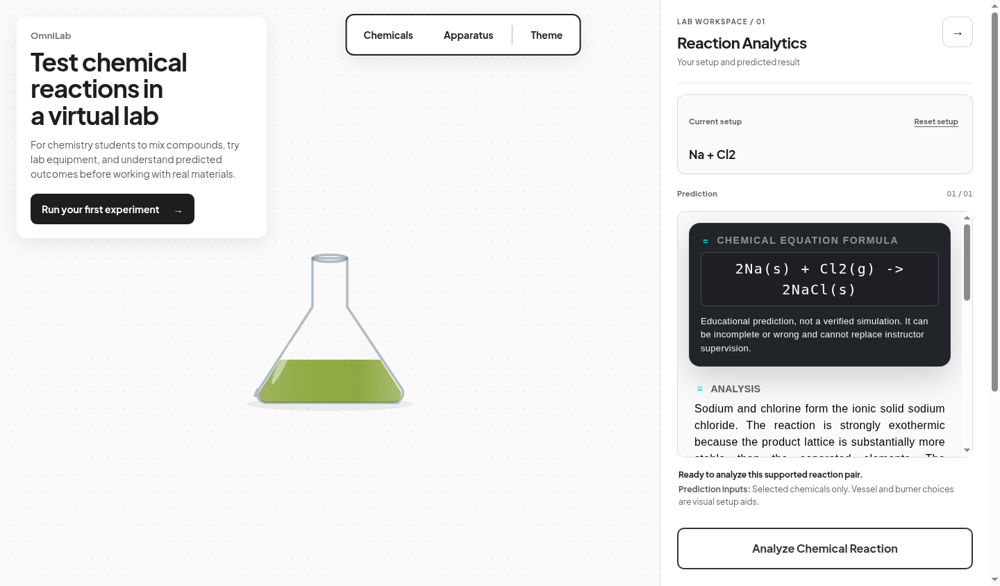

# OmniLab

OmniLab builds virtual labs for STEM learning. The chemistry lab is available now. An electronics lab is planned but is not available yet. The current public release is free and needs no account.

[Explore OmniLab](https://omnilab-bk8q.onrender.com/) · [Open the chemistry lab](https://omnilab-bk8q.onrender.com/lab/) · [Start the guided experiment](https://omnilab-bk8q.onrender.com/first-experiment/)



## What is available now

- A browser-based chemistry lab with 38 searchable substances and 34 supported, order-independent reaction pairs.
- Beakers, flasks, test tubes, a graduated cylinder, a pipette, a glass rod, filter paper, and a burner for setting up a virtual experiment.
- A reaction analysis panel that can be hidden to make more room for the workspace.
- An educational prediction for supported pairs, with an equation, explanation, safety guidance, and a link to a matching study guide.
- A [guided first experiment](https://omnilab-bk8q.onrender.com/first-experiment/), prepared demos, and a [chemistry guide library](https://omnilab-bk8q.onrender.com/guides/).
- Browser storage for the current setup and last supported result, with a Reset control.

The electronics lab is marked **Coming soon**. It is not part of the current release.

## Start with the supported demo

The prepared demo opens the real lab with Sodium and Chlorine already selected. It does not submit anything automatically, so the visitor remains in control of whether to request the prediction.

1. Open the [prepared Sodium and Chlorine demo](https://omnilab-bk8q.onrender.com/demo/sodium-chlorine/).
2. Review the selected chemicals and setup.
3. Select **Analyze Chemical Reaction** to request the educational prediction.

## Educational and safety limits

OmniLab returns a stored educational reaction for supported chemical pairs selected in the browser. Its equations, explanations, and safety guidance simplify real chemistry and can be incomplete for a particular physical setup. Check important information against trusted chemistry sources and follow an instructor's guidance, trained supervision, and the safety procedures of any physical laboratory.

The current chemistry lab supports a defined matrix of common reactions. It is an educational prediction tool, not a validated chemistry simulation. Vessel and burner choices are visual setup aids; only the selected chemicals determine the prediction. The lab does not reproduce every real-world condition, concentration, catalyst, or energy requirement.

## Run locally

Create a virtual environment and install the Python dependencies:

```bash
python3 -m venv .venv
source .venv/bin/activate
pip install -r requirements.txt
```

Prepare the local database and start Django:

```bash
python manage.py migrate
python manage.py runserver
```

Then open `http://127.0.0.1:8000/` for the STEM homepage or `http://127.0.0.1:8000/lab/` for the chemistry workspace.

Local development uses an explicitly non-production Django secret. Production
must provide `OMNILAB_DJANGO_SECRET_KEY` through protected environment settings;
copy `.env.example` to see the required variable without a committed value.

## Deploy with one command

After providing the required production environment variables, run:

```bash
./deploy/omnilab.sh
```

The command creates an isolated virtual environment, installs dependencies,
runs database migrations, collects static files, and starts Gunicorn. See the
[deployment guide](docs/deployment.md) for environment names, persistence,
health checks, and failure behavior.

## AI configuration

The current reaction library is deterministic and does not call an external AI model. If a future feature adds AI-backed functionality, `GITHUB_MODELS_API_KEY` is the only supported credential; copy `.env.example` to configure it locally.

## Tests

Run the Django test suite with:

```bash
python manage.py test
```

## Student research

Use the [version 1 student-session protocol](docs/student-session-protocol-v1.md)
for each outside-student session. It keeps the four evidence fields, supported
reaction boundary, completion rules, and no-coaching standard consistent.

## Built with

- Django and Gunicorn
- TypeScript compiled to browser modules
- HTML5 Canvas and Bootstrap
- A deterministic server-side reaction matrix

## License

OmniLab is available under the [MIT License](LICENSE).
